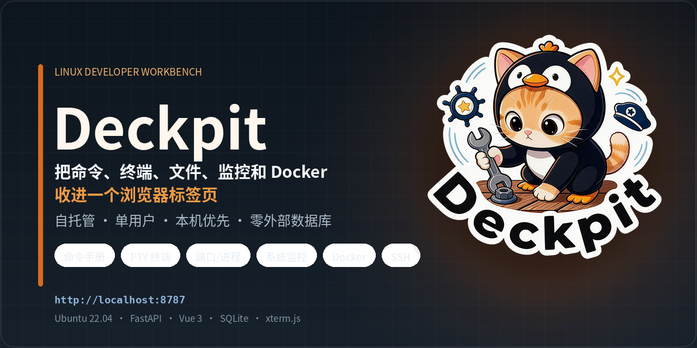
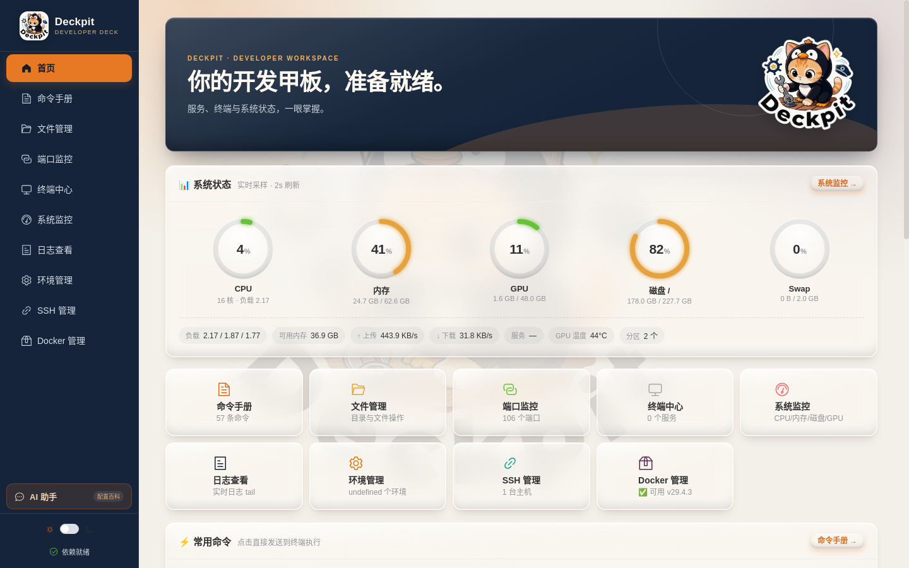
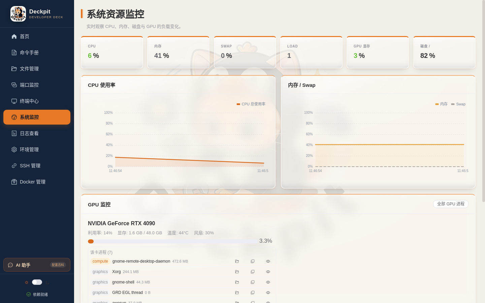
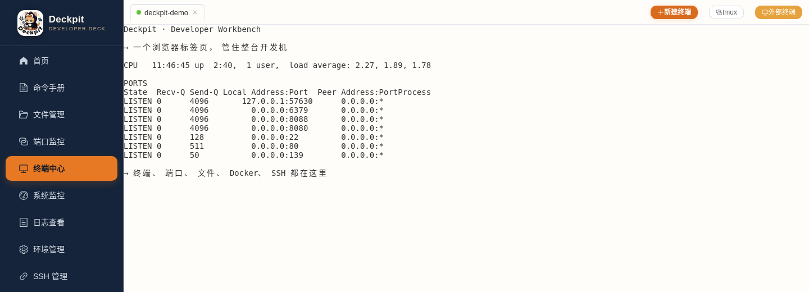
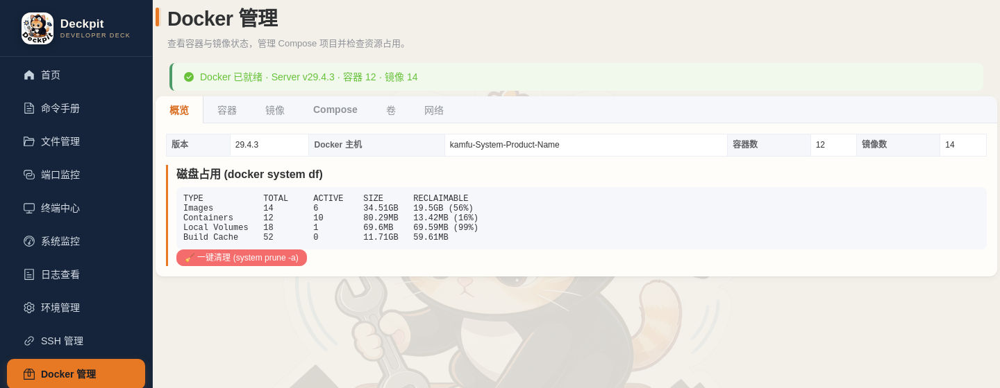
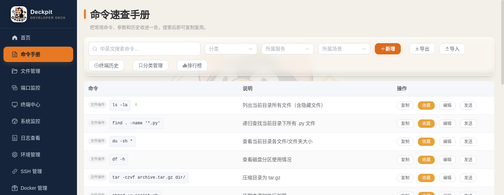
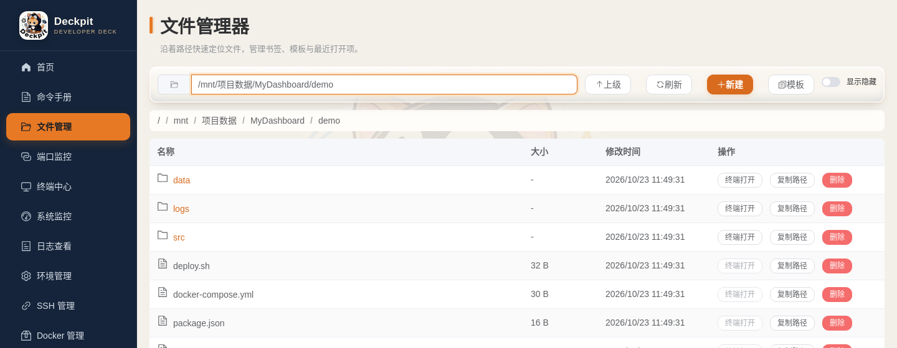
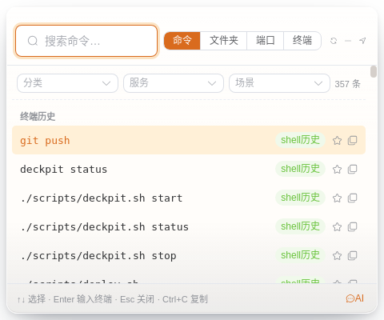

# Deckpit — 自建 Linux 开发者工作台

<p align="center">
  
</p>

<p align="center">
  
  
  
  
  
  
</p>

<p align="center">
  <strong>命令 · 终端 · 文件 · 端口 · 监控 · Docker · SSH</strong><br>
  一个运行在 <code>http://localhost:8787</code> 的自托管开发工作台
</p>

> **Deckpit** = Deck（甲板/卡片面板）+ Cockpit（驾驶舱）——一块卡片式面板，当你的开发驾驶舱。

一个运行在 `http://localhost:8787` 的本地 Web 工作台，把开发者日常高频操作——**命令速查、文件管理、端口/进程、终端、系统监控、日志、环境、SSH、Docker**——统一到一个页面里：可看、可搜、可点、可拖。

面向单用户（开发者本人），基准环境 **Ubuntu 22.04 + GNOME**，零外网依赖。默认监听 `0.0.0.0:8787` 以便局域网内其他机器访问，但**本机访问免登录、非本机访问需账号密码**（未配置口令时非本机一律拒绝）。

<p align="center"><a href="#部署"><strong>→ 快速开始 / 部署</strong></a></p>

## 界面预览

<p align="center">
  
  
</p>
<p align="center"><sub>首页 · 系统状态、快捷入口与服务概览 &nbsp;&nbsp;|&nbsp;&nbsp; 系统监控 · CPU / 内存 / GPU / 磁盘</sub></p>

<p align="center">
  
  
</p>
<p align="center"><sub>终端中心 · 多标签 PTY 与命令历史 &nbsp;&nbsp;|&nbsp;&nbsp; Docker 管理 · 容器、镜像与 Compose</sub></p>

<p align="center">
  
  
</p>
<p align="center"><sub>命令手册 · 搜索 / 收藏 / 一键发送 &nbsp;&nbsp;|&nbsp;&nbsp; 文件管理器 · 浏览、书签与模板</sub></p>

<p align="center">
  
</p>
<p align="center"><sub>QuickPalette · Ctrl+Shift+Space 随时唤起</sub></p>

## 解决什么问题

多项目并行开发时，桌面被一堆终端窗口和文件管理器塞满："这个端口被谁占了？"、"哪个终端跑的是哪个服务？"、"那条命令上次怎么写的来着？"——本项目把答案收进一个浏览器标签页：

| 痛点 | 对应模块 |
|------|----------|
| 常用指令记不住、反复上网查 | 命令手册 + 悬浮小屏 |
| 文件夹开多了找不到、新建文件靠命令行 | 文件管理器 |
| 端口占用不知道是哪个服务、哪启动的 | 端口监控 |
| 多终端不知道哪个跑啥 | 终端中心（可命名/状态灯） |
| 命令历史搜索弱、alias 散乱 | 终端历史 + shell 历史自动同步 |
| 多服务日志分散、GPU/CPU 监控 | 日志查看器 + 系统监控 |
| 多 venv / Node 版本 / .env 串味 | 环境管理 |
| SSH 会话散乱 | SSH 管理 + 一键连接 |

## 功能总览

### 🖥️ 首页面板
- CPU / 内存 / GPU / 磁盘实时状态条（点击跳转系统监控）
- 各模块快捷入口卡片（带运行状态摘要）
- **常用终端**：备注 + 路径，一键在本机打开外部终端
- **服务运行管理**：把一个项目服务定义为「多步骤启动命令 + 占用端口 + 工作目录」，支持启动 / 停止 / 状态查看 / 端口监听检查 / 开机自启
- 磁盘大文件 Top、项目（Project）聚合管理

### 📖 命令手册
- 出厂预置 50+ 常用 Linux 命令（文件 / 网络 / 进程 / 磁盘 / AI / Docker / Git 等分类）
- 每条含用途说明、参数逐项解释、使用示例
- 中英文模糊搜索、收藏置顶、自定义增删改、一键复制
- **四来源命令历史自动收录**：面板终端输入、外部终端发送、手册发送、`~/.bash_history` / `~/.zsh_history` 后台增量同步；历史可一键转存为命令条目
- JSON 导入 / 导出，使用频次统计与 Top 榜

### 📁 文件管理器
- 目录浏览 + 面包屑导航 + 路径直接跳转
- 新建文件/文件夹、重命名、删除、复制、移动（删除需二次确认）
- 快捷位置书签、最近打开文件、文件模板库（.py / .sh / Dockerfile / .env / docker-compose.yml 等 8 种）
- 右键联动：在此打开终端 / 用 VSCode 打开 / 复制绝对路径 / 系统文件管理器打开
- 磁盘占用方块图（du 下钻）、检测并管理桌面已开的 Nautilus 窗口（聚焦 / 关闭 / 别名）

### 🔌 端口监控
- 监听端口表格：端口号 / 协议 / 状态 / PID / 进程名 / 启动命令 / 启动路径
- 行展开详情：完整 cmdline、工作目录、启动用户、**父进程链**（一眼看清服务由谁拉起）
- 一键 kill（SIGTERM / SIGKILL，二次确认）、自动刷新
- 全量进程列表（按 CPU / 内存排序、搜索）、systemd user/system 服务管理（start/stop/restart/enable）
- 僵尸 / 孤儿进程识别、端口快照保存与差异对比

### ⌨️ 终端中心（核心）
- **内嵌 xterm.js 多标签 PTY 终端**：每标签独立会话，双击命名（如 "AI-推理服务"、"前端-nginx"）
- 状态灯（绿=空闲 / 黄=有输出）、resize、选择 shell 与初始目录
- **会话持久化**：PTY 进程活在后端，刷新 / 重开页面后自动恢复（scrollback 回放 + 接实时流）
- **外部终端窗口控制**（wmctrl + xdotool）：列出本机所有终端窗口、设别名、聚焦 / 关闭 / 直接向指定窗口发送命令执行
- 命令发送到当前活动终端、tmux 会话列表与接管

### 📊 系统监控
- CPU（总体 + 每核）、内存 + Swap、磁盘 I/O 与分区、网络速率实时曲线（ECharts，2s 刷新，保留 5 分钟历史）
- **GPU 监控**（pynvml）：每卡显存 / 利用率 / 温度 / 功耗 / 风扇；无 N 卡时自动隐藏
- GPU 进程列表与详情（进程名 / 命令行 / 工作目录 / 父进程链）
- 磁盘大文件 Top（识别模型权重）、系统依赖（wmctrl/xdotool）检查与一键安装

### 📄 日志查看器
- 大文件分页流式读取（>100MB 不卡）+ 实时 tail 模式（WS 推送，可暂停）
- 级别自动高亮（ERROR 红 / WARN 黄 / INFO 蓝）、正则搜索、关键词过滤、多日志标签页
- 多日志聚合视图、时间戳时间线对齐、ERROR 出现触发告警订阅

### 🐍 环境管理
- 自动探测 Python（系统 / venv / Conda）/ Node（nvm）/ uv / CUDA 环境，支持自定义路径扫描与备注
- 每环境包列表（优先 uv，回退 pip/conda）、一键导出 requirements.txt、两环境包差异对比
- `.env` 查看与编辑（敏感值默认打码，可切换原文）
- CUDA / Driver / PyTorch / TensorFlow 版本与兼容性提示

### 🔗 SSH 管理
- 主机 CRUD（名称 / IP / 端口 / 用户 / 密钥 / 跳板机）+ 在线状态探测（ping + TCP）
- 一键连接：自动在终端中心新开标签执行 ssh
- 远程路径收藏、`~/.ssh/config` 解析与一键导入

### 🐳 Docker 管理
- 容器列表 / 详情 / 日志 / 资源统计，容器操作（start / stop / restart / kill / rm）
- 镜像列表与拉取、Compose 项目（up / down / restart / ps / config）
- 卷、网络管理、系统信息与一键 prune

### 🎯 悬浮小屏（QuickPalette）
- pywebview 无边框置顶小窗，聚合「命令手册 + 终端历史」模糊查找
- **AI 模式**：在悬浮窗里直接提问，复用网页端会话、流式输出、token 统计和动作确认；模型配置只在网页端「AI 助手 → 设置」提供
- AI 模式默认使用更紧凑的字号；底部「尺寸」可设置默认窗口大小，切换到 AI 时自动应用，切回命令模式恢复原尺寸
- **自动吸附**：检测到你在用终端时贴其右缘显示，切走自动隐藏
- 全局快捷键 `Ctrl+Shift+Space` 唤起，系统托盘常驻；支持"点即发送到活动终端"

### 🤖 AI 助手
- 右侧抽屉，`Alt+A` 唤起；支持多轮、流式输出、Markdown/代码块、会话历史
- 每次回复结束展示本会话累计 token（输入 / 输出 / 合计）；模型未返回 usage 时自动标记“估算”
- 每个代码块和整条回复都有复制按钮；局域网 HTTP 访问时会回退到兼容复制方式
- **配置百科**：直接问「我配置了哪些服务」「MyDashboard 后端怎么启动、端口多少」「我有哪些常用终端」「哪些容器在运行」，AI 会读项目/服务/命令/终端/SSH/Docker/日志源/环境配置，并区分“配置值”和“当前状态”
- **白名单启停**：对已有服务、Docker 容器/Compose 提议 start / stop / restart；必须点确认才执行，执行后展示“前 → 后”状态
- 模型走 OpenAI-compatible 协议，本地 Ollama / vLLM 优先，也可接 DeepSeek / OpenAI；API Key 服务端加密存储
- 明确不做：任意命令执行、文件读写、进程 kill、Docker 删除/prune、SSH 远端执行、向终端注入命令

## 技术栈

| 层 | 技术 |
|----|------|
| 后端 | Python 3.11 + FastAPI + Uvicorn + aiosqlite |
| 前端 | Vue 3 + Vite + Element Plus + Pinia + Vue Router |
| 终端 | xterm.js + Python `pty`（fork + PTY 池管理） |
| 图表 | ECharts (vue-echarts) |
| 实时通信 | WebSocket（终端 I/O / 监控推送 / 日志 tail 三通道） |
| AI | OpenAI-compatible（Ollama / vLLM / DeepSeek / OpenAI）+ `httpx` 流式 |
| Markdown | markdown-it + highlight.js + DOMPurify |
| 系统采集 | psutil + pynvml + `ss` / `/proc` 解析 |
| 桌面集成 | wmctrl + xdotool + pywebview（悬浮小屏） |
| 存储 | SQLite 单文件（19 张表） |
| 部署 | venv + systemd user service |

## 架构

```
┌──────────────────────────────────────────────────────┐
│  浏览器 http://localhost:8787                         │
│  Vue3 SPA ── Element Plus ── xterm.js ── ECharts     │
└──────┬────────────────────────┬──────────────────────┘
       │ REST (/api/*)          │ WebSocket (/ws/*)
       ▼                        ▼
┌──────────────────────────────────────────────────────┐
│  FastAPI (uvicorn, :8787)                            │
│  ├─ routers/   10 个模块路由（命令/文件/端口/终端/     │
│  │             监控/日志/环境/SSH/首页/Docker）        │
│  ├─ services/  PTY 池·端口解析·监控采样·Docker CLI·    │
│  │             外部终端控制·shell 历史同步·tmux 等     │
│  ├─ ws/        终端桥接 / 监控推送 / 日志 tail         │
│  └─ SQLite     data/dashboard.db（19 张表）           │
└──────┬───────────┬──────────────┬────────────────────┘
       ▼           ▼              ▼
   psutil/      pty +         subprocess
   pynvml       bash/zsh      (ss, docker, wmctrl,
   /proc                       xdotool, systemctl...)
```

三类数据流：CRUD 走 REST；监控指标 / 日志增量走服务端 WS 推送；终端 stdin/stdout 走双向 WS。

## 部署

### 先理解它的权限等级

Deckpit 以**运行它的那个用户**的身份工作，能力边界 = 该用户的 shell：

| 能力 | 范围 |
|------|------|
| 执行命令 | 任意命令（内嵌 PTY 终端、向外部终端注入、服务启动脚本） |
| 文件读写 | 该用户有权访问的全部路径（默认 `ALLOWED_ROOTS = /`） |
| 进程管理 | 结束该用户的任意进程、管理 systemd 用户服务 |
| Docker | 若用户在 `docker` 组，等同 root（可挂载宿主机目录） |
| 敏感信息 | 读取项目 `.env`、SSH 配置 |

三条红线：**不要用 root 运行**、**不要把端口暴露到公网**、**口令不要用弱密码**。

### 一键部署（推荐）

适用于已经拿到项目目录的机器。正常部署只跑这一条：

```bash
cd /mnt/项目数据/MyDashboard
./scripts/deploy.sh
```

它会：

1. 缺 `backend/.venv` 时用 `uv` 创建并安装 Python 依赖；
2. 缺 `frontend/dist` 时用 `npm ci && npm run build` 构建；
3. 校验 Python 依赖和 dist 资源；
4. 执行 P0：登录账号/口令、文件权限、Docker、UFW；
5. 执行 P1：systemd user 服务、linger、历史 1s、小屏自启、日志轮转；
6. 重启并做健康检查。

常用参数：

```bash
./scripts/deploy.sh --yes --generate          # 非交互，自动生成 24 位口令
./scripts/deploy.sh --no-docker --no-ufw      # 跳过 Docker/UFW
./scripts/deploy.sh --no-systemd              # 只做 P0，保持手动启停
./scripts/deploy.sh --no-palette              # 不启动/不自启悬浮小屏
./scripts/deploy.sh --lan-cidr 192.168.4.0/24 # 指定允许访问的网段
```

生命周期：

```bash
./scripts/deploy.sh upgrade                   # 备份 + 更新依赖/dist + 重启
./scripts/deploy.sh upgrade --no-build        # 只更新后端依赖，不重建前端
./scripts/deploy.sh backup                    # 备份 .env + db + .ssh_key
./scripts/deploy.sh restore <archive>         # 恢复备份并重启
./scripts/deploy.sh verify                    # 校验 venv 依赖 + dist 资源 + 运行状态
./scripts/deploy.sh uninstall                 # 移除 systemd/自启/logrotate，保留数据
./scripts/deploy.sh uninstall --purge         # 连数据一起删（二次确认）
./scripts/deploy.sh uninstall --remove-files  # 额外删 .venv / node_modules / dist
```

`uninstall` 默认**不删项目、不删 `data/`、不删 `backend/.env`**；Docker 组和 UFW 规则也不会自动回滚，只打印手动命令。

> 旧 `setup.sh` / `start.sh` 已合并进 `deploy.sh`，不需要再单独运行。
> `p0-setup.sh` / `p1-setup.sh` 是内部阶段脚本，正常部署不要手动调用。

### 系统准备

`deploy.sh` 不负责安装 apt 包；先装好这些（Ubuntu 22.04）：

```bash
sudo apt update
sudo apt install -y \
  python3 python3-venv python3-pip \
  iproute2 curl ca-certificates util-linux \
  tmux wmctrl xdotool x11-utils ffmpeg sshpass \
  policykit-1 ufw mesa-utils \
  python3-gi python3-gi-cairo gir1.2-gtk-3.0 gir1.2-webkit2-4.0
```

Ubuntu 24.04 把 `gir1.2-webkit2-4.0` 换成 `gir1.2-webkit2-4.1`。

Python 环境管理用 [uv](https://astral.sh/uv)：

```bash
curl -LsSf https://astral.sh/uv/install.sh | sh
```

Node >= 18 只在需要构建 `frontend/dist` 时需要；如果已有 dist，或者使用离线包，目标机器不需要 Node。

服务**运行本身不需要 sudo**；sudo 只用于装依赖、配防火墙、开启 linger、写 logrotate。

### 离线部署

在联网机器上打离线包：

```bash
./scripts/deploy.sh bundle
# 或指定输出
./scripts/deploy.sh bundle --output release/deckpit-offline.tar.gz
```

包内包含：后端源码、`frontend/dist`、`vendor/wheels`、脚本和 `OFFLINE-README.md`；不包含 `.env`、`data/`、密钥。

目标机器（预装 Python >= 3.10 + 上面的系统包）解压后：

```bash
tar xzf deckpit-offline-*.tar.gz
cd deckpit
./scripts/deploy.sh --offline
```

`--offline` 用 `vendor/wheels` 建 venv、直接使用包内 dist，不联网、不跑 npm。wheelhouse 与构建机器的 OS / 架构 / Python 小版本绑定，目标机最好同为 Ubuntu x86_64 + 相同 Python 版本。

### 日常管理

```bash
./scripts/deckpit.sh status
./scripts/deckpit.sh start
./scripts/deckpit.sh stop
./scripts/deckpit.sh restart
./scripts/deckpit.sh logs -f
./scripts/deckpit.sh doctor
./scripts/deckpit.sh palette start|stop|status
```

`status` 返回码：`0` 运行、`3` 停止、`4` 异常（端口在监听但 `/api/health` 不可用）。

### 脚本说明

| 脚本 | 用途 | 需要手动跑吗 |
|------|------|--------------|
| `scripts/deploy.sh` | 唯一部署入口：安装/升级/备份/恢复/卸载/离线包/校验 | **是，正常只用它** |
| `scripts/deckpit.sh` | 日常启停、状态、日志、doctor、小屏 | 是 |
| `scripts/p0-setup.sh` | P0 阶段：口令/权限/Docker/UFW | 内部，deploy 调用 |
| `scripts/p1-setup.sh` | P1 阶段：systemd/linger/历史/小屏自启 | 内部，deploy 调用 |
| `scripts/run-prod.sh` | 生产后端启动（托管 dist） | 内部，deckpit 调用 |
| `scripts/start-palette.sh` | 悬浮小屏启动 | 内部/自启调用 |
| `scripts/fix-docker-perms.sh` | Docker socket/组修复 | 内部，P0 调用 |
| `scripts/quickpalette.py` | 悬浮小屏宿主 | 不直接跑 |

### 配置文件

部署配置统一在 `backend/.env`（权限 600）：

```bash
DASH_HOST=0.0.0.0
DASH_PORT=8787
DASH_AUTH_USER=admin
DASH_AUTH_PASSWORD=你的口令
```

说明：

- `DASH_AUTH_PASSWORD_HASH` 优先级高于明文，二选一；
- 本机 `127.0.0.1` 默认免登录（`DASH_AUTH_LOCAL_BYPASS=1`）；
- 局域网访问必须登录；
- 同一台机器挂反向代理时，把 `DASH_AUTH_LOCAL_BYPASS=0`，否则所有请求都会被当作本机放行；
- 修改后需要 `./scripts/deckpit.sh restart`。

## 项目结构

```
Deckpit/
├── backend/
│   ├── main.py               # FastAPI 入口：路由注册·预置数据·后台任务·SPA 托管
│   ├── auth.py               #   远程访问认证：按来源判定 + 口令校验 + 会话 + ASGI 中间件
│   ├── config.py             # 全局配置（端口/采样间隔/回滚行数等，环境变量可覆盖）
│   ├── database.py           # SQLite 连接与 19 张表建表迁移
│   ├── routers/              # 10 个 REST 路由模块
│   │   ├── commands.py       #   命令手册 + 终端历史
│   │   ├── files.py          #   文件管理 + 书签/模板/Nautilus 窗口
│   │   ├── ports.py          #   端口/进程/systemd/僵尸/快照
│   │   ├── terminal.py       #   PTY/tmux/外部终端/常用终端/服务运行管理
│   │   ├── system.py         #   系统监控 + GPU 进程 + 依赖安装
│   │   ├── logs.py           #   日志分页/搜索/聚合/告警
│   │   ├── env.py            #   环境探测/.env/CUDA
│   │   ├── ssh.py            #   SSH 主机/远程收藏/config 导入
│   │   ├── dashboard.py      #   首页聚合/项目/一键操作
│   │   ├── docker.py         #   容器/镜像/卷/网络/compose
│   │   └── ai.py             #   AI 会话/配置百科/动作确认
│   ├── services/             # 业务服务
│   │   ├── pty_manager.py    #   PTY 会话池（核心：fork+pty+scrollback 回放）
│   │   ├── monitor_service.py#   psutil/pynvml 采样循环（动态频率）
│   │   ├── port_service.py   #   ss 解析 + /proc inode 反查 + 父进程链
│   │   ├── docker_service.py #   Docker CLI 封装
│   │   ├── external_terminal.py # wmctrl+xdotool 外部终端控制
│   │   ├── history_sync.py   #   shell 历史后台增量同步
│   │   ├── ai/               #   Provider/Catalog/Tools/Actions/Chat
│   │   └── ...               #   env/log/tmux/dependency/file/clipboard
│   ├── ws/                   # 3 个 WebSocket 端点
│   │   ├── terminal_ws.py    #   终端双向桥（重连先回放 scrollback）
│   │   ├── monitor_ws.py     #   监控快照推送（2s 活跃/10s 空闲）
│   │   └── log_ws.py         #   日志 tail + ERROR 告警
│   └── requirements.txt
├── frontend/
│   └── src/
│       ├── views/            # 11 个页面视图（含 QuickPalette）
│       ├── components/       # DependencyBanner + ai/（抽屉/消息/动作卡片）
│       ├── stores/           # Pinia（terminal/system/ai）
│       ├── api/              # axios 封装 + WS 客户端 + AI 流式
│       └── router/           # 路由配置
├── scripts/
│   ├── deploy.sh            # 唯一部署入口：安装/升级/备份/恢复/卸载/离线包/校验
│   ├── deckpit.sh           # 日常启停/状态/日志/doctor/小屏
│   ├── p0-setup.sh          # 内部阶段：口令/权限/Docker/UFW
│   ├── p1-setup.sh          # 内部阶段：systemd/linger/历史/小屏自启
│   ├── run-prod.sh          # 内部：生产后端启动（托管 dist）
│   ├── start-palette.sh     # 内部：悬浮小屏启动
│   ├── fix-docker-perms.sh  # 内部：Docker socket/组修复
│   └── quickpalette.py      # 悬浮小屏宿主
├── assets/
│   ├── readme-banner.png    # README 封面
│   └── screenshots/         # 界面截图
├── data/
│   └── dashboard.db         # SQLite 数据库（运行时生成）
└── README.md                # 用户文档
```

## API 概览

REST 前缀：`/api/commands`、`/api/files`、`/api/ports`、`/api/processes`、`/api/systemd`、`/api/terminal`、`/api/system`、`/api/logs`、`/api/env`、`/api/ssh`、`/api/docker`、`/api/dashboard`、`/api/ai`

WebSocket 端点：

| 路径 | 方向 | 说明 |
|------|------|------|
| `/ws/terminal/{session_id}` | 双向 | 终端 stdin/stdout；重连首帧为 scrollback 回放 |
| `/ws/system/monitor` | 服务端推 | 监控快照，默认 2s 一帧 |
| `/ws/logs/tail?path=` | 服务端推 | 日志增量，检测到 ERROR 触发告警 |

启动后访问 `http://localhost:8787/docs` 查看完整 OpenAPI 文档。

## 配置

后端配置集中在 `backend/config.py`，均可通过环境变量覆盖，关键项：

| 配置项 | 默认值 | 说明 |
|--------|--------|------|
| `PORT` | `8787` | 服务端口 |
| `MONITOR_INTERVAL` | `2.0s` | 活跃时监控采样间隔 |
| `PTY_SCROLLBACK_LINES` | `5000` | 终端回滚缓冲行数 |
| `PTY_MAX_SESSIONS` | `20` | 最大并发终端会话数 |
| `HISTORY_SYNC_INTERVAL` | `5.0s` | shell 历史同步间隔 |
| `DISK_ALERT_THRESHOLD` | `0.90` | 磁盘使用率预警阈值 |
| `DASH_AI_ENABLED` | `1` | AI 助手总开关 |
| `DASH_AI_BASE_URL` | `http://127.0.0.1:11434/v1` | OpenAI-compatible 模型地址 |
| `DASH_AI_MODEL` | 空 | 模型名，如 `qwen2.5:14b` |
| `DASH_AI_API_KEY` | 空 | 云端模型 Key（也可在页面设置里填，服务端加密） |
| `DASH_AI_TIMEOUT` | `120` | 模型请求超时（秒） |
| `DASH_AI_CONTEXT_BUDGET` | `32000` | 估算 token 预算；本地 8k 模型请调小 |
| `DASH_AI_ALLOW_CLOUD` | `0` | 是否允许公网模型地址 |
| `DASH_AI_ACTION_MODE` | `confirm_all` | 动作确认策略 |

环境变量名统一带 `DASH_` 前缀（如 `DASH_HISTORY_SYNC_INTERVAL`），上表列的是 `config.py` 里的常量名。

### AI 助手配置

1. 本地模型（推荐）：先启动 Ollama / vLLM，确认有 OpenAI-compatible 的 `/v1` 接口。
2. 在 `backend/.env` 或页面「AI 助手 → 设置」里填：

```bash
DASH_AI_BASE_URL=http://127.0.0.1:11434/v1
DASH_AI_MODEL=qwen2.5:14b
# 云端才需要：
# DASH_AI_API_KEY=...
# DASH_AI_ALLOW_CLOUD=1
```

3. 重启后端，打开页面点侧边栏「AI 助手」，或按 `Alt+A`。
4. 设置页有「测试连接」；没有模型时可用 `DASH_AI_PROVIDER=mock` 做 UI 联调（Mock 不会执行任何动作）。

AI 的能力边界：只查询已配置信息 + 对已有服务/容器/Compose 提议启停；不执行任意命令、不读写文件、不 kill 进程、不做 SSH 远端操作。所有动作都需要前端确认，并写入 `ai_actions` 审计表。

本地验收：

```bash
cd backend && .venv/bin/python -m pytest -q
cd ../frontend && npm run build
```

## 局域网 / 远程访问

默认监听 `0.0.0.0:8787`，但**认证策略区分来源**：

| 访问来源 | 是否需要登录 |
|----------|--------------|
| 服务端本机（`127.0.0.1` / `::1`） | 免登录，与以前完全一致 |
| 其他机器（局域网 / 公网） | 必须账号密码登录 |

### 开启远程登录

编辑 `backend/.env`：

```bash
DASH_AUTH_USER=admin
DASH_AUTH_PASSWORD='你的强密码'
# 不想用明文：DASH_AUTH_PASSWORD_HASH=$(printf '%s' '密码' | sha256sum | awk '{print $1}')
```

然后重启：

```bash
./scripts/deckpit.sh restart
```

启动后会打印可访问地址：

```
监听: 0.0.0.0:8787
本机访问: http://localhost:8787
局域网访问: http://192.168.0.159:8787
```

**未设置口令时，非本机访问一律返回 403（fail-closed）**，不会出现"已开放但无口令"的窗口期。

只想退回纯本机访问：把 `backend/.env` 的 `DASH_HOST` 改为 `127.0.0.1`，然后：

```bash
./scripts/deckpit.sh restart
```

### 防火墙（建议只放行内网段）

```bash
sudo ufw allow from 192.168.0.0/24 to any port 8787   # 仅局域网段
sudo ufw status
```

### 相关配置项

| 配置项 | 默认值 | 说明 |
|--------|--------|------|
| `DASH_HOST` | `0.0.0.0` | 监听地址 |
| `DASH_AUTH_USER` | `admin` | 登录用户名 |
| `DASH_AUTH_PASSWORD` | 空 | 登录口令（空 = 拒绝非本机访问） |
| `DASH_AUTH_PASSWORD_HASH` | 空 | 口令的 sha256 摘要，优先级高于上一项 |
| `DASH_AUTH_SESSION_TTL` | `43200` | 会话有效期（秒） |
| `DASH_AUTH_LOCAL_BYPASS` | `1` | 本机来源免登录，置 `0` 则本机也要登录 |
| `DASH_AUTH_MAX_FAILS` | `5` | 同一来源连续失败上限，超出锁定 |
| `DASH_AUTH_LOCK_SECONDS` | `300` | 触发失败上限后的锁定时长（秒） |
| `DASH_TRUST_PROXY` | `0` | 用 `X-Forwarded-For` 判定来源；仅挂可信反代时置 `1` |

说明与限制：

- 会话保存在**服务端内存**，服务重启后所有远程客户端需重新登录。
- 认证 Cookie 为 `HttpOnly` + `SameSite=Lax`，前端静态资源放行以便未登录时能渲染登录页；真正受保护的是 `/api/*`（除 `/api/auth/*`）、`/ws/*`、`/docs`、`/openapi.json`。
- 未登录的 WebSocket 握手会被以 `1008` 关闭，前端据此停止重连并跳转登录页。
- `DASH_TRUST_PROXY=1` 时伪造 `X-Forwarded-For: 127.0.0.1` 即可绕过认证，**仅在你确实挂了可信反向代理时才开启**。
- 传输为明文 HTTP，跨公网使用请在前面套一层 HTTPS 反向代理。

## 让终端命令实时进入历史

四个来源都会自动收录进「终端历史」，且**同一条命令只保留一行**——重复执行不会堆出重复行，而是把它的时间戳刷新为最新、排到历史最前面（时间戳为毫秒精度，同秒连敲也能正确排序）。

| 来源 | 是否实时 | 需要设置 |
|------|----------|----------|
| 面板内终端（Dashboard 自带 PTY） | 实时，回车即上报 | 无 |
| 外部终端「发送命令」按钮 | 实时 | 无 |
| 命令手册「发送」 | 实时 | 无 |
| 外部终端里手敲的命令 | 后台增量同步历史文件 | 见下 |

前三者由前端在命令提交时直接调 `POST /commands/history`。外部终端里手敲的命令只能从 shell 历史文件里同步，而 **bash 默认只在 shell 退出时才写 `~/.bash_history`**，所以必须让 shell 每条命令执行后立即落盘：

```bash
# ~/.bashrc
shopt -s histappend
PROMPT_COMMAND="history -a${PROMPT_COMMAND:+; $PROMPT_COMMAND}"
```

```zsh
# ~/.zshrc
setopt INC_APPEND_HISTORY      # 每条命令执行后立即写入；共享多终端可用 SHARE_HISTORY
```

之后后台任务会按 `DASH_HISTORY_SYNC_INTERVAL`（默认 5 秒）增量读取，想更接近实时就调小。改 `backend/.env`：

```bash
DASH_HISTORY_SYNC_INTERVAL=1
DASH_HISTORY_GLOBAL=0
DASH_HISTORY_MAX_ENTRIES=500
```

然后 `./scripts/deckpit.sh restart`。也可以在「命令手册 → 终端历史 → 收录设置」里直接改同步间隔并保存。

说明：

- 只读取 `~/.bash_history` / `~/.zsh_history`（`HISTORY_GLOBAL=1` 时扩展为 `/home/*`）；自定义 `HISTFILE` 不在此列。
- 若设置了 `HISTTIMEFORMAT`，bash 会写入 `#<epoch>` 时间戳行，这类行会被忽略，不会被当成命令收录。
- 同步进度（每个历史文件的字节偏移）存在 `settings` 表里，重启服务后会接着上次位置继续，离线期间敲的命令也会补录。

## 外部终端接管（远程操作服务器上的终端）

「终端中心 → 外部终端」列出的窗口属于**服务器桌面（X11）**，聚焦/关闭只在服务器端生效，远程浏览器看不到画面。要在远程机器上操作它们，用「**接管到浮窗**」：

### 只读查看（任何终端都能用，包括正在跑服务的）

定时抓取该窗口画面（ffmpeg `x11grab`）显示在浏览器浮窗里：**能看到里面的真实内容，但不能发送任何指令**。刷新频率可选 1 / 2 / 5 秒或暂停，也可拖动和最大化。

这是唯一能"看到"一个已在运行的终端里内容的通用办法 —— 已存在终端的输出流无法事后读取（pty 的消费者唯一），终端模拟器也不对外提供滚动缓冲区。

限制：只能看到**当前可见的一屏**，拿不到已滚出屏幕的历史；窗口被遮挡时会先把它提到最前再抓。依赖 `ffmpeg`。

### 接管（可双向操作，有条件）

要让浮窗里的终端**能输入**，用「接管到浮窗」，前提是 `tmux`：

1. 该终端此前被接管过 → 直接复用其 tmux 会话（不会反复嵌套注入）；
2. 该终端的 shell 本来就在 tmux 里 → 直接 attach，能看到它的完整回滚；
3. 否则向该窗口注入 `exec tmux new-session -A -s deckpit-w<窗口XID>`，把当前 shell 挂进 tmux，再在浏览器浮窗里 attach。

接管后是一个可拖动 / 可最大化 / 可缩放的浏览器浮窗，**双向实时同步**：服务器上那个终端的输入输出，和你在这里敲的完全一致。关闭浮窗不会终止会话，可在终端中心找回。

已知边界：

- **接管之前的输出不会带过来**（新的 tmux pane 从接管时刻开始）；要包含已有历史，那个终端必须本来就在 tmux 里。
- 终端前台正在跑程序（vim / top / 交互程序）时注入的命令会被它当输入吞掉，接管会超时失败 —— 请先回到 shell 提示符。
- GNOME Terminal 属于"单进程多窗口"终端，所有窗口共享一个 `gnome-terminal-server` 进程，因此**无法提前判断目标窗口是否空闲**，只能尝试注入并按超时判定成败；会话按窗口 XID（而非 PID）命名，避免多个窗口串台。
- 依赖服务器安装 tmux：`sudo apt install tmux`。

## 安全设计

- 默认不暴露外网；无遥测、无外网回调
- 认证按来源区分：本机免登录，非本机必须账号密码（详见[局域网 / 远程访问](#局域网--远程访问)）
- 未配置 `DASH_AUTH_PASSWORD` 时非本机访问直接拒绝，登录失败超限自动锁定来源
- 危险操作（kill 进程、删除文件、覆盖写入）一律要求前端二次确认
- kill 默认 SIGTERM，SIGKILL 需显式选择；展示完整 cmdline 防误杀
- 文件操作经 `Path.resolve()` 前缀校验，拒绝 `..` 与符号链接逃逸
- `.env` 敏感值展示默认打码
- AI 动作只接受“目标 ID + 白名单动作”，不接受模型生成的 shell 命令；动作必须前端确认，并写入 `ai_actions` 审计
- AI 上下文不含 SSH 密码、`.env` 原值、Provider Key；模型只能查询配置和对已有对象提议启停

## 已知限制

- 外部终端窗口控制（wmctrl/xdotool）与悬浮小屏吸附依赖 X11，Wayland 下不可用
- GPU 监控仅支持 NVIDIA（pynvml / nvidia-smi）
- 远程主机管理未做——SSH 模块仅"发起连接"，不是远端面板
- systemd 用户服务由 `./scripts/deploy.sh` / `./scripts/p1-setup.sh` 安装；手动迁移目录后需重跑 P1
- 远程登录会话保存在服务端内存，服务重启后远程客户端需重新登录
- AI 助手需要单独配置模型；未配置时入口可用但只提示“未配置模型”，不影响主应用
- 服务运行状态保存在后端内存，后端重启后需重新查询/启动；AI 回答会标注状态来源
- 如果服务端口在监听但不是面板启动的进程，AI 会拒绝 stop/restart（无法安全接管外部进程）
- AI 的 Compose 动作用 `stop` 而不是 `down`（避免移除容器）；不会执行 `rm` / `prune` / `kill`
- AI 会话、动作审计保存在 SQLite；模型上下文里不含 SSH 密码、`.env` 原值和 API Key
- 终端输出文本镜像尚未接入 UI；`backend/services/terminal_log.py` 暂为未使用代码

## 文档

- 本 `README.md` 是面向最终用户的唯一部署/使用文档。
- 内部设计、评审、排错清单不随用户发布追踪；需要时由维护者本地保留。
